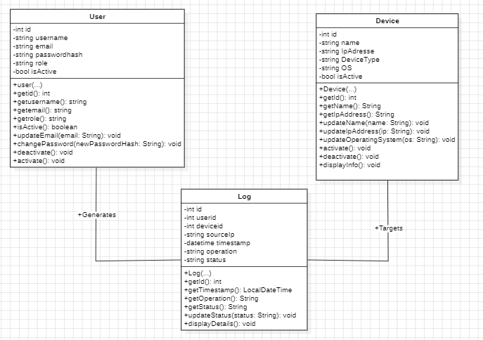

# Network Device Management System

A student project for managing network devices,
users, and activity logs using Java.

## UML Class Diagram

## Main Classes

- **User:** Manages application users and roles.
- **Device:** Stores network device information.
- **Log:** Records operations performed on devices.

## Technologies

- Java
- UML / StarUML
